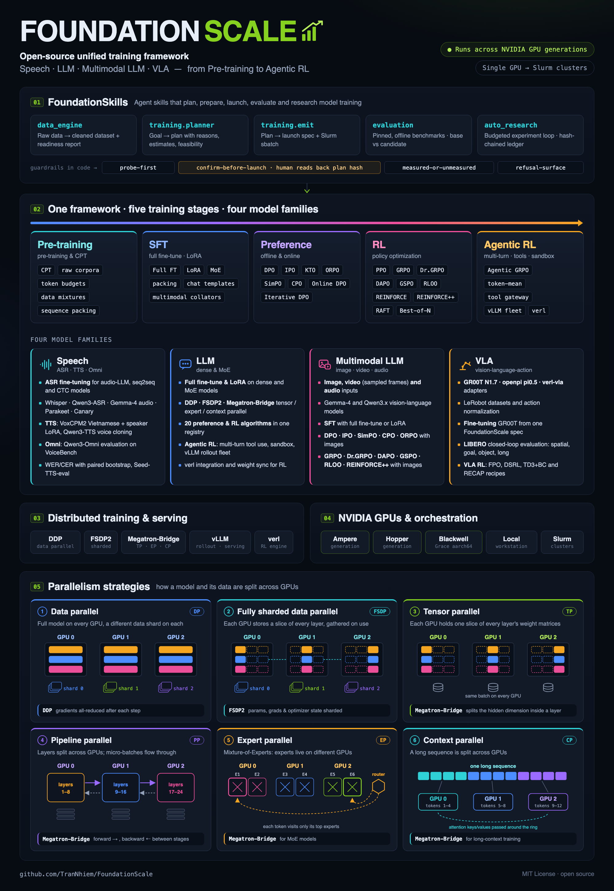
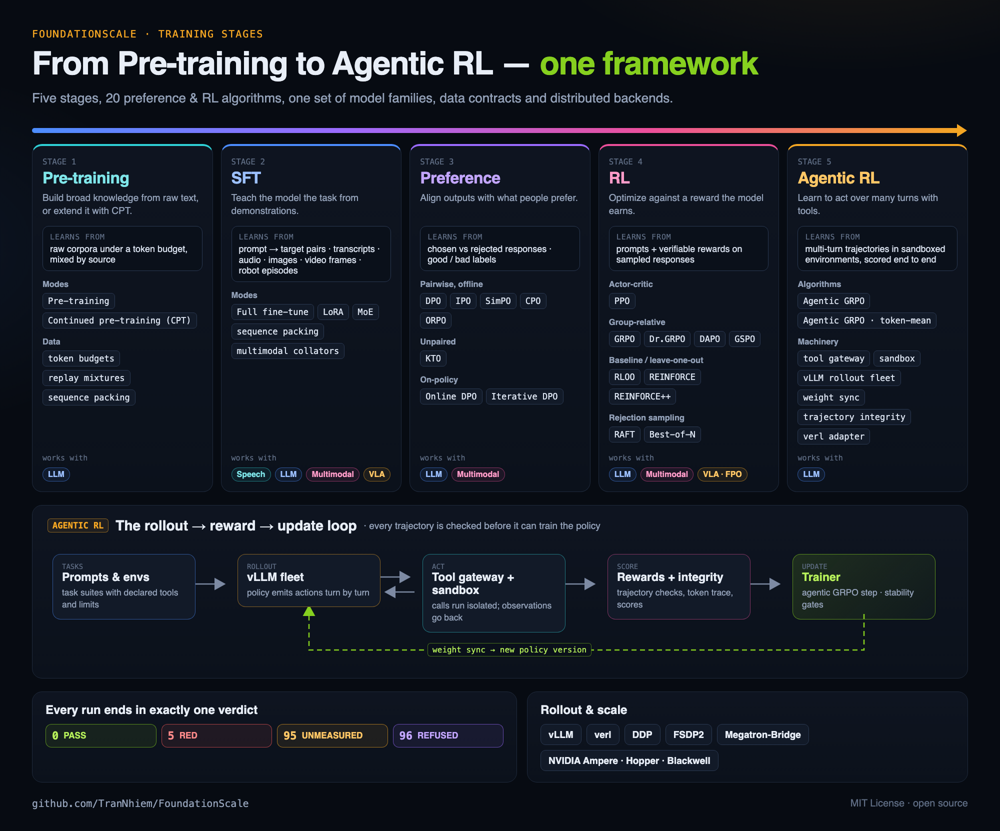
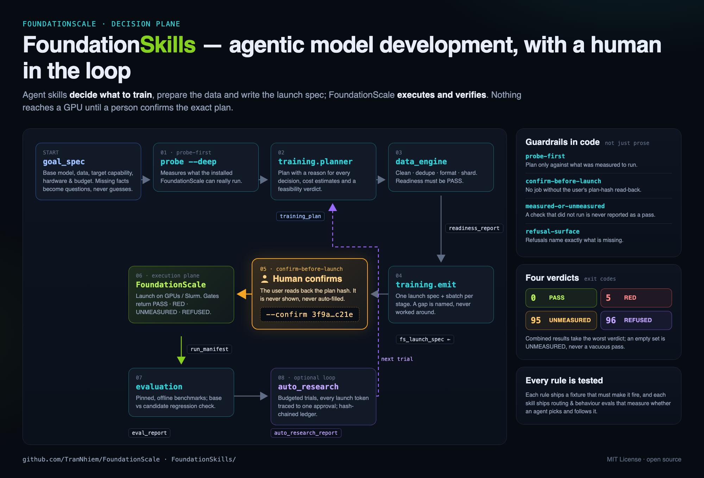

<p align="center">
  
</p>

<h1 align="center">FoundationScale</h1>

<p align="center">
  <b>Open-source unified training framework for Speech, LLM, Multimodal LLM and VLA — from pre-training to agentic RL.</b>
</p>

## What is FoundationScale

FoundationScale is an open-source framework for training AI models across the whole lifecycle —
pre-training and continued pre-training, supervised fine-tuning, preference optimization,
reinforcement learning and agentic RL — for speech, language, multimodal and
vision-language-action models.

It brings these into one framework built on proven engines — Hugging Face Transformers,
Megatron-Bridge, vLLM, verl, GR00T and openpi — so the same project scales from a single
GPU to a Slurm cluster. **FoundationSkills** adds an agent layer on top: describe a goal, and
agents prepare the data, plan the stages, write the launch spec and evaluate the result, with
your confirmation before anything runs.

## Highlights

- **Four model families** — Speech (ASR, TTS, Omni), LLM, Multimodal LLM and VLA.
- **Five training stages** — pre-training & CPT, SFT, preference optimization, RL and agentic RL.
- **20 preference & RL algorithms** in one registry, from DPO to GRPO, DAPO, GSPO and PPO.
- **Agentic RL** — multi-turn tool use in sandboxed environments with a vLLM rollout fleet.
- **FoundationSkills** — agents plan, prepare data, launch, evaluate and research, with a human confirmation step.
- **Measured recipes** — step-by-step examples that report the results they reached on real GPUs.
- **Scales out** — DDP, FSDP2 and Megatron-Bridge (TP / PP / EP / CP) on NVIDIA Ampere, Hopper and Blackwell, local or under Slurm.

## Training stages

<p align="center">
  
</p>

| Stage | What it covers | Learn more |
|---|---|---|
| Pre-training & CPT | Continued pre-training through the same `foundationscale-train` entry as SFT | [docs/TRAINING.md](docs/TRAINING.md) |
| SFT | Full fine-tune and LoRA, dense and MoE, text and multimodal | [docs/TRAINING.md](docs/TRAINING.md) |
| Preference | DPO, IPO, KTO, ORPO, SimPO, CPO, Online DPO, Iterative DPO | [docs/RL_ALGORITHMS.md](docs/RL_ALGORITHMS.md) |
| RL | PPO, GRPO, Dr.GRPO, DAPO, GSPO, RLOO, REINFORCE, REINFORCE++, RAFT, Best-of-N | [docs/RL_ALGORITHMS.md](docs/RL_ALGORITHMS.md) |
| Agentic RL | Agentic GRPO, tool gateway, sandbox, vLLM rollout fleet, verl adapter | [docs/AGENTIC_RL.md](docs/AGENTIC_RL.md) |

## Model families

| Family | Highlights | Learn more |
|---|---|---|
| Speech | ASR fine-tuning for audio-LLM, seq2seq and CTC models (Whisper, Qwen3-ASR, Gemma-4 audio, Qwen2-Audio, Parakeet, Canary); TTS with VoxCPM2 (incl. Vietnamese + speaker LoRA) and Qwen3-TTS; Qwen3-Omni evaluation; WER/CER with paired bootstrap | [examples/SPEECH.md](examples/SPEECH.md), [docs/research/speech.md](docs/research/speech.md) |
| LLM | Full fine-tune and LoRA on dense and MoE models; preference, RL and agentic RL | [examples/llm-2xA100](examples/llm-2xA100/README.md), [docs/AGENTIC_RL.md](docs/AGENTIC_RL.md) |
| Multimodal LLM | Image, video (sampled frames) and audio inputs; Gemma-4 and Qwen3.x VLMs; SFT, DPO-family and GRPO-family training with images | [examples/vlm-2xH200](examples/vlm-2xH200/README.md), [evidence](validation_campaigns/vlm_2xh200/EVIDENCE.md) |
| VLA | GR00T N1.7, openpi pi0.5 and verl-vla adapters; LeRobot data; GR00T fine-tuning; LIBERO closed-loop evaluation; FPO, DSRL, TD3+BC and RECAP RL recipes | [docs/research/vla.md](docs/research/vla.md) |

## FoundationSkills

<p align="center">
  
</p>

FoundationSkills is the agent layer: it decides *what* to train, and FoundationScale executes it.
It plans only against what the installed framework can actually run, and launches only after the
user confirms the plan.

| Skill | What it does |
|---|---|
| `data_engine` | Raw sources → cleaned, deduplicated, formatted dataset + readiness report |
| `training.planner` | Goal → stages, algorithm, method, resource estimate and feasibility |
| `training.emit` | Plan + dataset → launch spec and Slurm sbatch, confirmed by hash |
| `evaluation` | Checkpoint vs its base model on pinned, offline benchmarks |
| `auto_research` | Budgeted multi-trial research campaign on an append-only ledger |

Read more in [FoundationSkills/README.md](FoundationSkills/README.md); agents start at
[FoundationSkills/SKILLS.md](FoundationSkills/SKILLS.md).

## Installation

Requires Python ≥ 3.10.

```bash
git clone https://github.com/TranNhiem/FoundationScale && cd FoundationScale
python3 -m pip install -e ".[train]"          # training
pip install -e FoundationSkills               # optional: the agent layer (fskills CLI)
```

| Extra | Contents | Use it for |
|---|---|---|
| `train` | torch, transformers, datasets, accelerate | training |
| `checkpoint` | torch, safetensors, numpy | checkpoint gates |
| `dev` | pytest, ruff, mypy | development |
| `all` | everything | — |

Contributors: see [docs/GETTING_STARTED.md](docs/GETTING_STARTED.md) for the CPU-only install CI uses.

## Quick start

Train a tiny model end to end (20 steps, exits `0 PASS`):

```bash
python3 examples/train_tiny.py
```

Train from the command line on the bundled offline toy corpus (`foundationscale-train` is the same command):

```bash
python3 -m foundationscale.train.cli \
  --model sshleifer/tiny-gpt2 --dataset examples/data/toy_text.jsonl \
  --output-dir /tmp/fs_train_demo --profile-name local-single-node \
  --nodes 1 --gpus-per-node 1 --dp 1 --max-steps 8 --save-interval 4
```

Let an agent plan a run with FoundationSkills:

```bash
fskills probe --deep                  # what the installed FoundationScale actually runs
fskills plan  --goal goal.json        # goal -> training plan
```

More in [docs/GETTING_STARTED.md](docs/GETTING_STARTED.md).

## Examples

Step-by-step recipes with measured results:

| Recipe | Hardware | Guide |
|---|---|---|
| LLM LoRA SFT | 2× A100 | [examples/llm-2xA100](examples/llm-2xA100/README.md) |
| Vision-language models (SFT, preference, RL) | 2× H200 | [examples/vlm-2xH200](examples/vlm-2xH200/README.md) |
| VLM LoRA | 2× GB200 | [examples/vlm-2xGB200](examples/vlm-2xGB200/README.md) |
| VLM SFT | 2× A100 | [examples/vlm-2xA100](examples/vlm-2xA100/README.md) |
| ASR fine-tuning | 2× H200 | [examples/speech-2xH200](examples/speech-2xH200/README.md) |
| ASR fine-tuning | 2× A100 | [examples/speech-2xA100](examples/speech-2xA100/README.md) |
| Text-to-speech and voice cloning | GB200 | [examples/tts-GB200](examples/tts-GB200/README.md) |
| Omni speech-LLM (VoiceBench) | GB200 | [examples/omni-GB200](examples/omni-GB200/README.md) |
| All A100 recipes in one place | 2× A100 | [examples/A100_2GPU.md](examples/A100_2GPU.md) |

Index: [docs/EXAMPLES.md](docs/EXAMPLES.md) · speech hub: [examples/SPEECH.md](examples/SPEECH.md)

## Distributed training

- **Data parallel** — DDP and FSDP2, launched with `torchrun`.
- **Model parallel** — tensor, pipeline, expert and context parallelism through Megatron-Bridge.
- **Topology checks** — the declared parallel layout is validated before any process group starts.
- **Clusters** — Slurm and container launchers in [launchers/](launchers/).

See [docs/DISTRIBUTED.md](docs/DISTRIBUTED.md).

## Documentation

| Topic | Doc |
|---|---|
| Getting started | [docs/GETTING_STARTED.md](docs/GETTING_STARTED.md) |
| Architecture & design principles | [docs/ARCHITECTURE.md](docs/ARCHITECTURE.md), [docs/DESIGN_PRINCIPLES.md](docs/DESIGN_PRINCIPLES.md) |
| Training & configuration | [docs/TRAINING.md](docs/TRAINING.md), [docs/CONFIGURATION.md](docs/CONFIGURATION.md), [docs/WORKFLOWS.md](docs/WORKFLOWS.md) |
| Models & datasets | [docs/MODEL_INTEGRATION.md](docs/MODEL_INTEGRATION.md), [docs/DATASETS.md](docs/DATASETS.md) |
| Preference & RL | [docs/RL_ALGORITHMS.md](docs/RL_ALGORITHMS.md) |
| Agentic RL | [docs/AGENTIC_RL.md](docs/AGENTIC_RL.md) |
| Distributed training | [docs/DISTRIBUTED.md](docs/DISTRIBUTED.md) |
| Checkpointing | [docs/CHECKPOINTING.md](docs/CHECKPOINTING.md) |
| Verification & custom gates | [docs/VERIFICATION.md](docs/VERIFICATION.md), [docs/CUSTOM_GATES.md](docs/CUSTOM_GATES.md), [docs/VERIFICATION_MATRIX.md](docs/VERIFICATION_MATRIX.md) |
| Extending the framework | [docs/EXTENSION_POINTS.md](docs/EXTENSION_POINTS.md) |
| Monitoring & troubleshooting | [docs/OBSERVABILITY.md](docs/OBSERVABILITY.md), [docs/TROUBLESHOOTING.md](docs/TROUBLESHOOTING.md) |
| Status & roadmap | [docs/STATUS.md](docs/STATUS.md), [ROADMAP.md](ROADMAP.md) |

## Project layout

```
src/foundationscale/
  train/          training entry point (SFT, CPT, multimodal)
  rl/             preference & RL trainers, algorithm registry, Megatron lane
  agentic_rl/     multi-turn agentic RL: engines, environments, sandbox, gateway
  vla/            vision-language-action adapters (GR00T, openpi, verl-vla) and LIBERO eval
  gates/          verification gates and their controls
  checkpoint/     checkpoint manifests and parity checks
  provenance/     run manifests
  families/       model-family registry
  upstream/       integrations with upstream models and stacks
FoundationSkills/ agent layer (fskills CLI)
examples/         hardware-specific recipes
launchers/        Slurm and container launch scripts
docs/             documentation
tests/            test suite
validation_campaigns/  recorded evidence from real-hardware runs
```

## Status

- Every stage working for every model family is the goal; [ROADMAP.md](ROADMAP.md) tracks the combinations still being built.
- Curated from-scratch pre-training recipes and a unified data contract are on the roadmap.
- The launchers are worked examples for specific clusters, configured through environment variables.
- Algorithms without a linked hardware result are covered by tests, not benchmarks.

Details in [docs/STATUS.md](docs/STATUS.md).

## Contributing & development

```bash
make check        # lint, typecheck, tests, gate controls and repository checks — what CI runs
```

See [docs/CONTRIBUTING.md](docs/CONTRIBUTING.md), [docs/DEVELOPMENT.md](docs/DEVELOPMENT.md) and
[docs/TESTING.md](docs/TESTING.md).

## License

[MIT](LICENSE). Third-party notices: [THIRD_PARTY_NOTICES.md](THIRD_PARTY_NOTICES.md).
